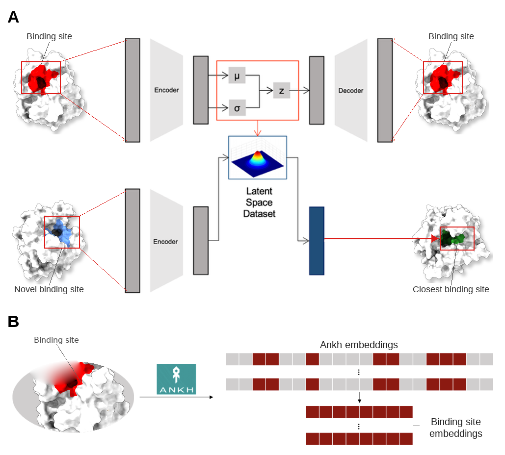

# LEN-Seek

<p align="center">
  
  
  
  
</p>

**LEN-Seek: Fast and scalable ligand binding-site similarity search in the latent space of an SE(3)-invariant graph VAE**

<p align="center">
  
</p>

<p align="center">
  <i>The graph VAE is trained to encode and reconstruct ligand binding sites (A). Once trained, its encoder maps every
  database site to a set of per-residue latent vectors, and a query site, whose node features are the Ankh embeddings of
  its residues (B), is compared with the database by the Chamfer distance between these sets.</i>
</p>

## Overview

LEN-Seek searches ligand binding sites in a latent space. A binding site is a graph of its amino-acid residues: the node
features are embeddings of the protein language model [Ankh](https://huggingface.co/ElnaggarLab/ankh-base), and the
edges encode SE(3)-invariant geometric relationships, so no data augmentation or SE(3)-equivariant model is needed. A
graph neural network-driven variational autoencoder encodes each site into one 256-dimensional latent vector per
residue; the encoded training data form the Latent Space Database, and two sites are compared by the L2 Chamfer
distance between their sets of latent vectors.

- **Concordance with ProBiS.** On the 448 binding sites of the evaluation data, LEN-Seek kept precision and recall above
  0.80 through the top-50 results, with a top-1 MCC of 0.7238 at a Chamfer distance of 42.5 (Table 1).
- **Agreement with G-LoSA.** For the top-100 results, the Chamfer distance and the G-LoSA GA-score have a Pearson
  correlation of −0.906.
- **Ligand similarity.** Of the top-100 pairs LEN-Seek classified as similar, 86.94 % bind ligands with a Dice
  similarity of 0.46 or higher, against 17.21 % of its dissimilar pairs (ProBiS: 83.89 % and 25.11 %).
- **Speed.** A query against the 114,661 training binding sites takes 2.79 s on 16 CPU cores, against 734.2 s for ProBiS
  and 362.7 s for G-LoSA on the same cores (a 263-fold lower cost per comparison than ProBiS), and 0.53 s on one GPU.
- **Larger databases.** A two-stage search recovered 83.8 % of the top-10 of the full search. When the Latent Space
  Database was enlarged 87-fold to 10⁷ sites, it recovered 79.8 % while its search time on one CPU core grew 1.7-fold.

## Quick start

```bash
conda create -n lenseek python=3.11 && conda activate lenseek
pip install --extra-index-url https://download.pytorch.org/whl/cpu -e ".[all]"
```

```bash
# four example sites against a 500-site excerpt of the database
examples/search.sh
# one site against the whole database
lenseek-search my_site/ --embed --top-k 100 --out hits.tsv
# the site around a ligand, then the search
python scripts/search_ligand.py complex.cif --ligand ATP:A:501 --out hits.tsv
```

- The searches need the `main_s0` checkpoint, and the whole-database search also the encoded database; place local
  copies as [CHECKPOINTS.md](CHECKPOINTS.md) describes. The example search returns, in order, the ten hits per query
  listed in `data/example/expected_hits.tsv`.
- Every default is the reported setting, except the database edition and file reader of `lenseek-search`
  (see [Search](#search)).
- For a GPU, replace the CPU index with the PyTorch index of your CUDA version; `environment.yml` pins the versions the
  models were trained and evaluated with. `pytest -q` runs the tests on CPU.
- The out-of-fold thresholds use the cross-validation folds of scikit-learn's `GroupKFold`, which differ between
  scikit-learn versions; the reported values were computed with scikit-learn 1.9.1, the version both install routes pin.

## What is in this repository

| | Where |
|---|---|
| Package and command-line tools (search, embedding, featurization, training) | `lenseek/` |
| Code behind every reported number | `scripts/` writes the intermediate files, `analysis/` turns them into the paper's numbers |
| Configuration of every reported training run, example sites | `data/` |
| Model checkpoints, evaluation outputs of `main_s0`, reference tables, archived copy of this release | the LEN-Seek data record |
| BsitePDB: the binding-site and protein files of the database and of the evaluation period | Zenodo record BsitePDB [doi:10.5281/zenodo.24492368](https://doi.org/10.5281/zenodo.24492368) |
| Training features, the reason each site was or was not used for training, the training and evaluation split, evaluation queries, list of the binding sites from later PDB entries, latent-space dataset | Zenodo record LEN-Seek data [doi:10.5281/zenodo.24491227](https://doi.org/10.5281/zenodo.24491227) |
| Intermediate results the analysis reads: ProBiS and G-LoSA scan scores, DeeplyTough and Folddisco scores and top-100 lists, sequence-identity and random rankings, timing logs, scoring outputs of the binding sites from later PDB entries, evaluation outputs of the seeds and variants, site annotation, scaling result tables | the LEN-Seek data record; `examples/*.sh` produce them |
| Synthetic databases and indexes of the larger-database study | not distributed; `examples/scaling.sh` rebuilds them, and their result tables are in the LEN-Seek data record |
| Checkpoints of the variants | not distributed; `data/runs.yaml` trains each of them |

Once the data records are public, `lenseek-fetch <name>` downloads each file (`lenseek-fetch --list`
names them) and `analysis/run.py` reads the unpacked files without further settings. Version 2.0 supersedes version 1.0
of the code.

## Usage

### Search

A query is a pocket file next to its protein file:

```
my_site/
├── protein.pdb              # every chain that has pocket residues
└── ligand_pocket_1_A.pdb    # any file name containing "pocket"
```

The pocket file holds the `ATOM` records of the binding-site residues (10 to 65 standard amino acids).
`lenseek-search <pockets or directories>` writes a table of `query`, `rank`, `site_id` and `chamfer_distance` (smaller is
more similar); `--embed` computes missing Ankh embeddings, `--model` / `--checkpoint` choose the model, `--db` searches a
database built with `lenseek-build-db`. `scripts/search_ligand.py` builds the pocket from a complex: the residues within
the van der Waals radius plus 4 Å of the ligand, the rule the database was built with.

`lenseek-search` reads pocket files with the strict reader (`--parser strict`, the default), which reads standard PDB
columns and insertion codes, and searches the standard edition of the database (`--edition standard`); `--edition paper
--parser legacy`, with the fixed-column reader the released features and database were built with, reproduces the
rankings reported in the paper. The two readers can read different coordinates from files in the original BsitePDB
column layout. The files of the BsitePDB record use the standard PDB columns; to rebuild the reported inputs with
`--parser legacy`, first restore the original column layout with `bsitepdb_to_legacy_layout.py` of that record (for
`BSDB_231103`, `BSDB_EX` and the evaluation queries) and point `LENSEEK_BSDB_ROOT` and `LENSEEK_QUERY_ROOT` at the
restored copies. Of the results of `analysis/run.py`, only the residue counts of Supplementary Figure S1 differ on the
standard-column files, where residues with insertion codes are counted separately.

LEN-Seek calls a database site similar to the query at a Chamfer distance of 42.5 or less.

### Training and evaluation

```bash
# train a run of data/runs.yaml (lenseek-train --run main_s0 --data <training features>)
examples/train.sh main_s0
# evaluate a checkpoint
python scripts/evaluate.py --checkpoint lenseek_main_s0.pth \
    --features <database features> --queries <query cache> \
    --out $LENSEEK_EVAL_ROOT/out_main_s0 --rotations
```

Training runs 200 epochs without a validation set and keeps the last state. `scripts/evaluate.py` writes the evaluation
folder every result script reads: encodings, distances and the rotation test.

### Reproducing the paper

```bash
python analysis/run.py --list     # every result, with the manuscript item it produces
examples/analysis.sh              # every result whose inputs are present
```

[`notebooks/reproduce_figures.ipynb`](notebooks/reproduce_figures.ipynb) runs the same results in order. Their inputs come
from these scripts:

| Example | Produces |
|---|---|
| `examples/labels.sh` | ProBiS and G-LoSA labels; DeeplyTough and Folddisco rankings |
| `examples/analysis.sh inputs` | site annotation, sequence clusters and strata of the evaluation queries |
| `examples/timing.sh` | the per-query timings of Table 2, on one exclusive node |
| `examples/holdout.sh` | the binding sites from later PDB entries and their one scoring run |
| `examples/scaling.sh` | the larger databases and the single-vector baselines |

Tools installed separately:

| Tool | Located via |
|---|---|
| ProBiS 2.4.7 | `$PROBIS_BIN`, or `probis` on `PATH` |
| G-LoSA 2.2 and Java | `$GLOSA_DIR` (or `$GLOSA_BIN`), `$JAVA_BIN` |
| DeeplyTough with MGLTools | `$DEEPLYTOUGH_HOME`, `$DT_PYTHON` (its Python 3.6 environment), `$MGL_ENV` |
| Folddisco 3.0.0 (3e193e3) | `$FOLDDISCO`, or `folddisco` on `PATH` |
| MMseqs2 18.8cc5c | `$MMSEQS`, or `mmseqs` on `PATH` |
| Foldseek 9.427df8a | `$FOLDSEEK`, or `foldseek` on `PATH` |

`python analysis/run.py -h` lists the environment variables that point at the inputs.

## Results

Concordance of the top-ranked results with ProBiS on the 448 binding sites of the evaluation data (Table 1 of the paper;
a Chamfer distance of 42.5 or less and a ProBiS Z-score of 2.0 or higher count as similar):

| Rank | Precision | Recall | F1 | MCC |
|---|---|---|---|---|
| 1 | 0.9018 | 0.9393 | 0.9202 | 0.7238 |
| 5 | 0.9032 | 0.9290 | 0.9159 | 0.7362 |
| 10 | 0.9040 | 0.9175 | 0.9107 | 0.7376 |
| 20 | 0.8848 | 0.9075 | 0.8960 | 0.7296 |
| 50 | 0.8444 | 0.8784 | 0.8611 | 0.7047 |
| 100 | 0.7828 | 0.8649 | 0.8218 | 0.6767 |

Comparison methods on the same queries (Supplementary Table S13 B; ProBiS metrics on 421 queries, ligand metrics on
435):

| Method | ProBiS ROC-AUC | Top-1 MCC | P@1 | Ligand ROC-AUC | RE@1% |
|---|---|---|---|---|---|
| **LEN-Seek** | 0.811 | 0.728 | 0.743 | 0.601 | 18.19 |
| DeeplyTough | 0.709 | −0.056 | 0.038 | 0.685 | 5.71 |
| Folddisco | 0.859 | 0.618 | 0.786 | 0.587 | 10.81 |
| Sequence-identity baseline | 0.692 | 0.533 | 0.613 | 0.527 | 6.28 |
| Random ranking | 0.499 | – | 0.005 | 0.502 | 0.95 |

- **Computation time (Table 2):** 2.79 s per query on 16 CPU cores and 0.53 s on one GPU, against 734.2 s for ProBiS and
  362.7 s for G-LoSA on the same 16 cores.
- **Further results:** the Supplementary results (out-of-fold thresholds, G-LoSA, strata, binding sites from later PDB
  entries, variants, node features and geometry, larger databases, computation time) are reproduced by
  `analysis/run.py`.

## Project structure

```
lenseek/          the package: model, search, featurization, training
scripts/          programs that write the intermediate files
analysis/         one script per reported result; run.py runs them by name
examples/         one shell script per workflow
data/             run configurations, example sites, query sets
notebooks/        quickstart and figure reproduction
tests/            CPU tests
CHECKPOINTS.md    checkpoints and the encoded database, with SHA-256
```

## Weights

[CHECKPOINTS.md](CHECKPOINTS.md) lists the trained checkpoints and the encoded database, their SHA-256, and how each
checkpoint is evaluated.

## Citation

Kyunghwan Yeo<sup>†</sup>, Dongwoo Kim<sup>†</sup>, Jaemin Sim, Juyong Lee. LEN-Seek: Fast and scalable ligand binding-site similarity search in the latent space of an SE(3)-invariant graph VAE. *bioRxiv* (2026). <sup>†</sup>These authors contributed equally.

```bibtex
@article{yeo2026lenseek,
  title   = {{LEN-Seek}: Fast and scalable ligand binding-site similarity search
             in the latent space of an {SE(3)}-invariant graph {VAE}},
  author  = {Yeo, Kyunghwan and Kim, Dongwoo and Sim, Jaemin and Lee, Juyong},
  note    = {Kyunghwan Yeo and Dongwoo Kim contributed equally},
  journal = {bioRxiv},
  year    = {2026},
  doi     = {10.64898/2026.08.14.744759}
}
```

The data records: Dongwoo Kim, Kyunghwan Yeo, Myunghyun Jang, Jaemin Sim, Juyong Lee. BsitePDB: ligand binding sites
from the Protein Data Bank. *Zenodo* (2026). https://doi.org/10.5281/zenodo.24492368 — Kyunghwan Yeo<sup>†</sup>,
Dongwoo Kim<sup>†</sup>, Jaemin Sim, Juyong Lee. LEN-Seek data: training features, evaluation and hold-out sets,
latent-space dataset and intermediate results. *Zenodo* (2026). https://doi.org/10.5281/zenodo.24491227

```bibtex
@misc{dongwoo2023bsdb,
  title        = {{BsitePDB}: ligand binding sites from the {Protein Data Bank}},
  author       = {Kim, Dongwoo and Yeo, Kyunghwan and Jang, Myunghyun and Sim, Jaemin and Lee, Juyong},
  year         = {2026},
  howpublished = {Zenodo},
  doi          = {10.5281/zenodo.24492368}
}

@misc{yeo2026lenseekdata,
  title        = {{LEN-Seek} data: training features, evaluation and hold-out sets, latent-space dataset and
                  intermediate results},
  author       = {Yeo, Kyunghwan and Kim, Dongwoo and Sim, Jaemin and Lee, Juyong},
  note         = {Kyunghwan Yeo and Dongwoo Kim contributed equally},
  year         = {2026},
  howpublished = {Zenodo},
  doi          = {10.5281/zenodo.24491227}
}
```

## License

The code is licensed under the Apache License 2.0 ([LICENSE](LICENSE), [NOTICE](NOTICE)). Ankh-base, which computes the
node features, is CC BY-NC-SA 4.0; PDB data is CC0 1.0; ProBiS, G-LoSA, DeeplyTough, Folddisco, MMseqs2, Foldseek,
RDKit, gemmi and faiss keep their own licenses, as do the ESM models of the node-feature variants (no ESM model,
embedding or derived weight is distributed here). The BsitePDB record is licensed under CC BY 4.0 (the PDB coordinates
it holds are CC0 1.0); the LEN-Seek data record is licensed under CC BY 4.0, with its Ankh embeddings under CC BY-NC-SA
4.0.
